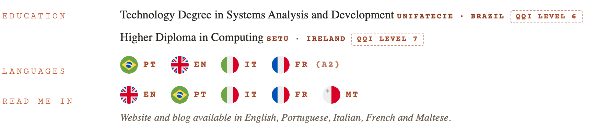
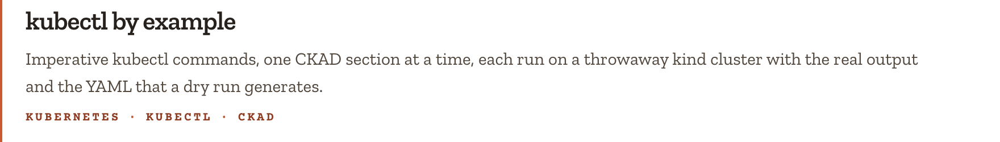
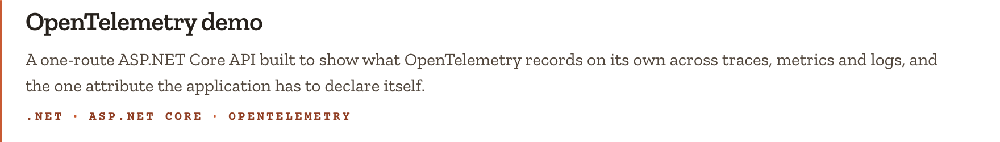
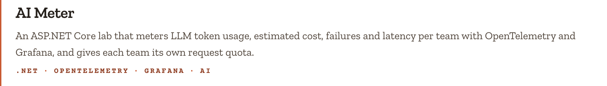

<picture>
  <source media="(prefers-color-scheme: dark)" srcset="assets/logo-dark.svg">
  
</picture>

[**Website**](https://danieldias.dev/en) · [**Blog**](https://danieldias.dev/en/blog) · [**LinkedIn**](https://www.linkedin.com/in/daniel-dias-504168113/) · [**Email**](mailto:daanspfc@gmail.com)

<picture>
  <source media="(prefers-color-scheme: dark)" srcset="assets/lead-dark.svg">
  
</picture>

Software developer focused on backend .NET. I build APIs and run the live projects below.

<picture>
  <source media="(prefers-color-scheme: dark)" srcset="assets/credentials-dark.png">
  
</picture>

## Tech

**Backend**

**Data**

**Cloud & CI**

**Interfaces in my projects**

## Projects

[**Sports Betting API**](https://github.com/DeVFirmino/SportsBetting)  
API in .NET 10 for one betting flow: deposit, choose a fixture, place a bet. The wallet debit and the bet commit together, a `rowversion` stops two requests spending the same balance, and a repeated idempotency key never debits twice. 
Tests: [concurrent bets against real SQL Server](https://github.com/DeVFirmino/SportsBetting/blob/develop/tests/Integration.Test/PlaceBetUseCaseTests.cs) 
.NET · ASP.NET CORE · SQL SERVER · AZURE · Deployed by hand to Azure Container Apps with Azure SQL in September 2026 · [Live API](https://sportsbetting-api.nicewave-b8afa4cf.westeurope.azurecontainerapps.io/swagger/index.html), scales to zero · [deployment notes](https://github.com/DeVFirmino/SportsBetting#deployment)

[**PayMaestro**](https://github.com/DeVFirmino/PayMaestro)  
One API in front of several simulated payment gateways. It reserves the idempotency key before any gateway call, moves to the next gateway on a soft decline, stops on a hard decline or a charge with no answer, and reconciles that charge with the provider instead of charging again. 
Tests: [idempotency race](https://github.com/DeVFirmino/PayMaestro/blob/main/tests/PayMaestro.Tests/IdempotencyReservationTests.cs) · [reconciliation](https://github.com/DeVFirmino/PayMaestro/blob/main/tests/PayMaestro.Tests/ReconciliationTests.cs) 
.NET · ASP.NET CORE · EF CORE · SQLITE

[**Fleet Analytics**](https://github.com/DeVFirmino/FleetAnalytics) 
Vehicle telemetry API. Each GPS reading adds the distance driven to the odometer and raises an alert when the vehicle speeds or is due for a service. The reading, its alerts and the odometer update commit in one transaction. 
Tests: [a failure after the alert is staged saves nothing](https://github.com/DeVFirmino/FleetAnalytics/blob/master/tests/FleetAnalytics.Tests/Services/TripLogIngestionAtomicityTests.cs) 
.NET · ASP.NET CORE · EF CORE · SQLITE

[**danieldias.dev**](https://danieldias.dev/en) 
The .NET site I build and run, with a blog in five languages. A local tool turns a draft into five language editions and validates each one before it opens a pull request. CI audits the dependencies, and the metrics endpoint sits behind a token. 
.NET · RAZOR PAGES · MARKDOWN · DOCKER · Source private

<picture>
  <source media="(prefers-color-scheme: dark)" srcset="assets/card-maltese-dark.png">
  
</picture>

[**Open live site ↗**](https://maltesetranscriber.mt) · Source private

[**URL Shortener**](https://github.com/DeVFirmino/UrlShortner)  
Three stateless .NET replicas behind nginx, Redis cache-aside in front of Cassandra and collision handling for short codes, all started with one Docker Compose command. 
.NET · REDIS · CASSANDRA · DOCKER

<b>Three more projects</b>

 

[**Good Hamburger**](https://github.com/DeVFirmino/good-hamburger) — order management API with combo discount rules, domain-level invariants and integration tests. 
.NET · ASP.NET CORE · EF CORE · XUNIT

[**Book Management**](https://github.com/DeVFirmino/BookManagment) — MVC library lending app. Session action filters keep clients out of the admin pages, and only an administrator can open the client list. That last filter is tested for an administrator, a client and a visitor with no session. 
.NET · ASP.NET CORE MVC · EF CORE · SQL

[**Portfolio Manager**](https://github.com/DeVFirmino/AvaloniaPortifolioManager) — desktop app for clients, investment portfolios, holdings and transactions, built with Avalonia and EF Core. 
.NET · AVALONIA · EF CORE · SQL

## Blog

.NET, Azure, AI and system design, in English, Portuguese, Italian, French and Maltese. [Read the blog ↗](https://danieldias.dev/en/blog) · [RSS](https://danieldias.dev/en/blog/feed.xml)

**Latest posts**

<!-- BLOG-POST-LIST:START -->
- [Half a million small databases: how Brazil counts 125 million votes in one night](https://danieldias.dev/en/blog/how-brazil-counts-125-million-votes-in-one-night) · Oct 2026
- [How troubleshooting changed from the 1950s to 2026](https://danieldias.dev/en/blog/troubleshooting-from-the-1950s-to-2026) · Oct 2026
- [Azure Cosmos DB for RAG: benefits and when to choose it over a relational database](https://danieldias.dev/en/blog/azure-cosmos-db-for-rag-benefits-and-when-to-choose-it) · Sep 2026
- [Kubernetes taints and tolerations explained with a theme park](https://danieldias.dev/en/blog/kubernetes-taints-and-tolerations) · Sep 2026
- [When the LLM gets lost, ask it to update the harness](https://danieldias.dev/en/blog/ask-the-model-to-update-the-harness) · Sep 2026<!-- BLOG-POST-LIST:END -->

**Code that goes with the posts**

<a href="https://github.com/DeVFirmino/kubectl-by-example">
  <picture>
    <source media="(prefers-color-scheme: dark)" srcset="assets/card-kubectl-dark.png">
    
  </picture>
</a>

<a href="https://github.com/DeVFirmino/dotnet-opentelemetry-search">
  <picture>
    <source media="(prefers-color-scheme: dark)" srcset="assets/card-otel-dark.png">
    
  </picture>
</a>

<a href="https://github.com/DeVFirmino/ai-meter">
  <picture>
    <source media="(prefers-color-scheme: dark)" srcset="assets/card-ai-meter-dark.png">
    
  </picture>
</a>

[**LLM harness example**](https://github.com/DeVFirmino/llm-harness-example) — the files an LLM reads before it answers, kept in a repository and updated by review. Goes with [When the LLM gets lost, ask it to update the harness](https://danieldias.dev/en/blog/ask-the-model-to-update-the-harness).

[**AZ-900 Study Guide**](https://github.com/DeVFirmino/AZ900-Studies) — Azure Fundamentals from the concepts up, not memorised answers. Goes with [How I passed AZ-900](https://danieldias.dev/en/blog/how-i-passed-az-900).

## Contact

I'm open to backend .NET roles and freelance projects involving APIs and integrations.

<picture>
  <source media="(prefers-color-scheme: dark)" srcset="assets/open-to-work-dark.png">
  
</picture>

