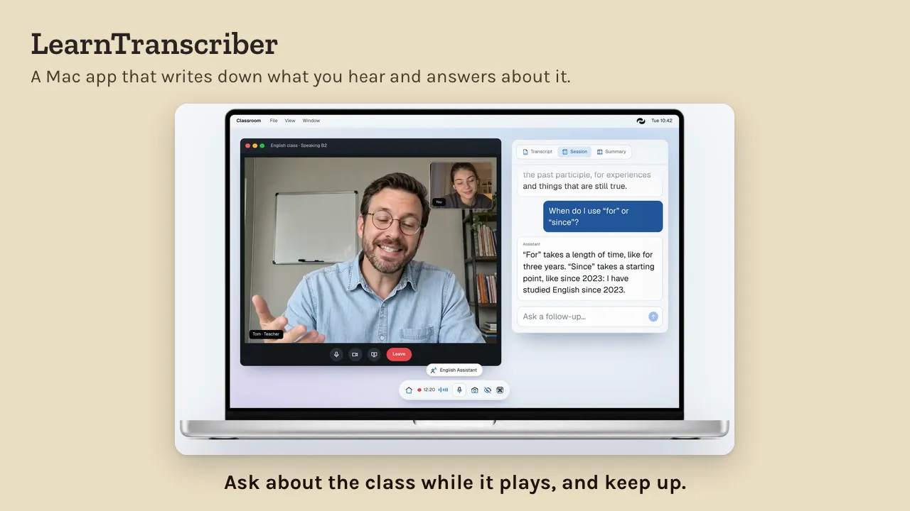
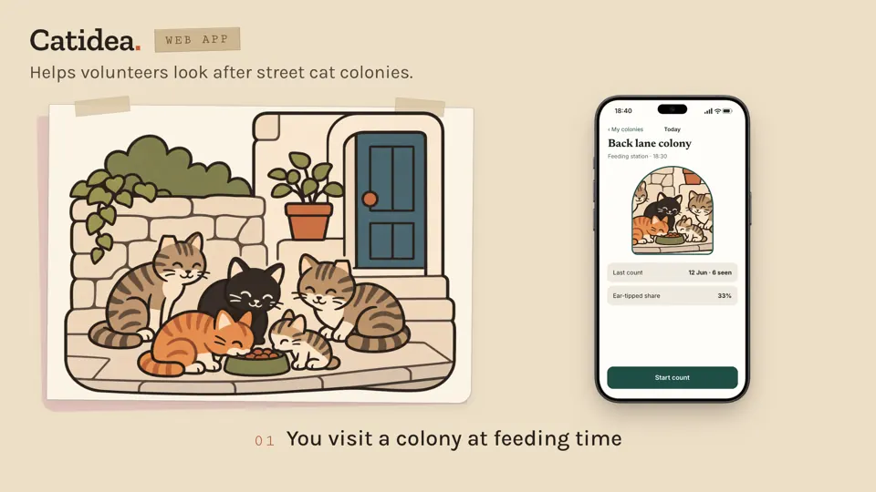
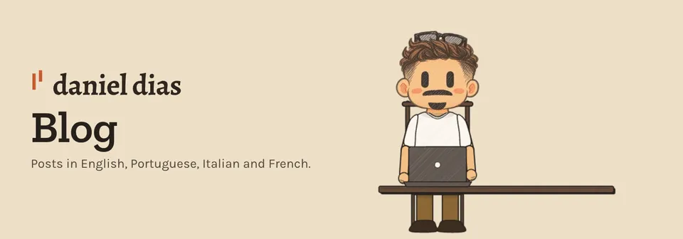
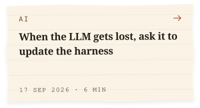
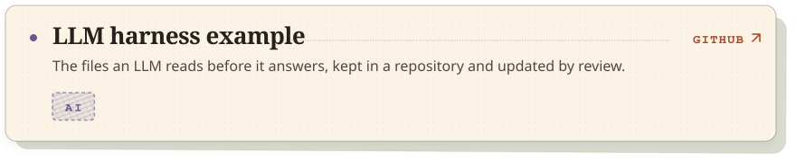
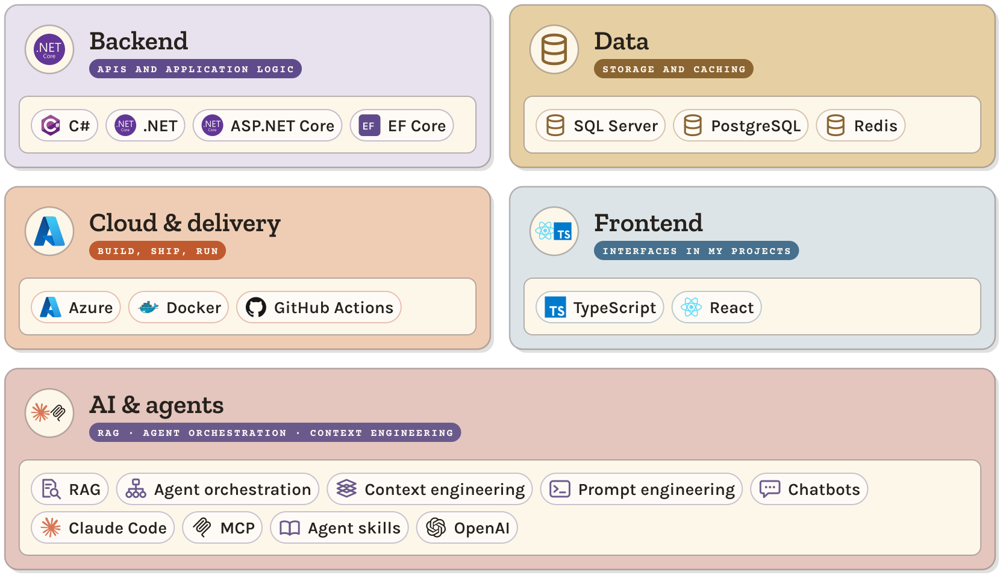

<picture>
  <source media="(prefers-color-scheme: dark)" srcset="assets/logo-dark.svg">
  
</picture>

[**Website**](https://danieldias.dev/en) · [**Blog**](https://danieldias.dev/en/blog) · [**Email**](mailto:daanspfc@gmail.com)

<a href="https://danieldias.dev/en"><picture>
  <source media="(prefers-reduced-motion: reduce)" srcset="assets/hero-still.png">
  
</picture></a>

<picture>
  <source media="(prefers-color-scheme: dark)" srcset="assets/lead-dark.svg">
  
</picture>

Software developer focused on backend .NET. I build APIs and run the live projects below.

## Projects

### [LearnTranscriber](https://github.com/DeVFirmino/learntranscriber) 

Read a class or a meeting as it is said, and ask about it without pausing.

<a href="https://github.com/DeVFirmino/learntranscriber"><picture>
  <source media="(prefers-reduced-motion: reduce)" srcset="assets/how-it-works/learntranscriber-still.png">
  
</picture></a>

Open-source macOS app in Electron, React and Swift. Speech is transcribed on the Mac with Apple Speech or a local Whisper server, or by a cloud service; a floating assistant answers with the AI you choose (a ChatGPT sign-in, an API key or a local model), and sessions stay in a local SQLite database. 
[Download for Mac ↗](https://github.com/DeVFirmino/learntranscriber/releases/latest/download/LearnTranscriber-arm64.dmg) · [Homebrew](https://github.com/learntranscriber/homebrew-tap) · [Website](https://learntranscriber.danieldias.dev) · [Source](https://github.com/DeVFirmino/learntranscriber) · [How it works](https://github.com/DeVFirmino/learntranscriber#how-it-works) 
ELECTRON · REACT · SWIFT · AI · Free and open source under the MIT license

### [racha-bot](https://github.com/DeVFirmino/racha-bot) 

The weekly football list goes round the WhatsApp group, and two fair teams come back in seconds.

<a href="https://github.com/DeVFirmino/racha-bot"><picture>
  <source media="(prefers-reduced-motion: reduce)" srcset="assets/how-it-works/rachabot-still.png">
  
</picture></a>

WhatsApp bot in .NET 10 for a weekly pickup game. It reads the group's list the way people already write it, checks who has paid and draws two balanced teams with a goalkeeper in each, sent back as an image card drawn with ImageSharp. It connects through a self-hosted WAHA gateway, checks the signature on every webhook and answers only commands; a local simulator shows the card without a WhatsApp number. 
[Source](https://github.com/DeVFirmino/racha-bot) · [Try it without WhatsApp](https://github.com/DeVFirmino/racha-bot#teste-em-1-minuto-sem-whatsapp) (in Portuguese) 
.NET · WHATSAPP · IMAGESHARP · DOCKER · Free and open source under the MIT license

### Ocllo

Ocllo sits in the Mac's notch while your AI assistant writes code. You answer it there, and each finished turn gets a second opinion.

<picture>
  <source media="(prefers-reduced-motion: reduce)" srcset="assets/how-it-works/ocllo-still.png">
  
</picture>

macOS companion in Swift for Claude Code, Codex and Copilot CLI. The agents report their sessions to Ocllo on the Mac through their own hooks; a permission or a question drops from the notch as a card you can answer, and Claude, on your own account, gives each finished turn a short verdict. Nothing is sent for review until you allow it for that project. 
Source private 
SWIFT · MACOS · REACT · AI · In progress, no public download yet

### Catidea

Volunteers count the cats at each colony from their phone, and the team sees how every colony changes over time.

<picture>
  <source media="(prefers-reduced-motion: reduce)" srcset="assets/how-it-works/catidea-still.png">
  
</picture>

Census platform for groups that look after street cat colonies. A count records what one person saw and is never edited, the share of ear-tipped cats is the headline number because it tracks how many are already neutered, and colony locations stay behind a sign-in. ASP.NET Core with EF Core on PostGIS, a React and TypeScript client, and reports in CSV and PDF. 
Source private 
.NET · POSTGIS · REACT · TYPESCRIPT

### [AI Meter](https://github.com/DeVFirmino/ai-meter)

Two teams share one AI. Every answer adds to that team's bill, and when one team reaches its limit the other keeps going.

<a href="https://github.com/DeVFirmino/ai-meter"><picture>
  <source media="(prefers-reduced-motion: reduce)" srcset="assets/how-it-works/aimeter-still.png">
  
</picture></a>

ASP.NET Core lab that meters LLM token usage, estimated cost, failures and latency per team with OpenTelemetry and Grafana. Each team has its own request limit: once its window is spent the API answers 429 with `Retry-After`, while the other teams keep theirs. 
[Source](https://github.com/DeVFirmino/ai-meter) · [Blog post](https://danieldias.dev/en/blog/ai-meter-usage-and-cost-per-team) · [Lab guide](https://github.com/DeVFirmino/ai-meter/blob/main/docs/lab-guide.md) 
.NET · OPENTELEMETRY · GRAFANA · AI · Simulated usage, no real spending

### [URL Shortener](https://github.com/DeVFirmino/UrlShortner) 

Turns a long link into a short one that opens the right page for whoever taps it.

<a href="https://github.com/DeVFirmino/UrlShortner"><picture>
  <source media="(prefers-reduced-motion: reduce)" srcset="assets/how-it-works/urlshortner-still.png">
  
</picture></a>

Three stateless .NET replicas behind nginx, Redis cache-aside in front of Cassandra and collision handling for short codes, all started with one Docker Compose command. 
[Source](https://github.com/DeVFirmino/UrlShortner) 
.NET · REDIS · CASSANDRA · DOCKER

### [danieldias.dev](https://danieldias.dev/en)

My site and blog, in five languages.

<a href="https://danieldias.dev/en"><picture>
  <source media="(prefers-reduced-motion: reduce)" srcset="assets/how-it-works/danielsite-still.png">
  
</picture></a>

The .NET site I build and run. A local tool turns a draft into five language editions and validates each one before it opens a pull request. CI audits the dependencies, and the metrics endpoint sits behind a token. 
[Live site ↗](https://danieldias.dev/en) · Source private 
.NET · RAZOR PAGES · MARKDOWN · DOCKER

<b>Six more projects</b>

 

[**Sports Betting API**](https://github.com/DeVFirmino/SportsBetting) — betting API where tapping Bet twice by accident charges you once, and two bets at the same moment can't spend the same balance. [Live API ↗](https://sportsbetting-api.nicewave-b8afa4cf.westeurope.azurecontainerapps.io/swagger/index.html) (scales to zero) 
.NET · ASP.NET CORE · SQL SERVER · AZURE

[**PayMaestro**](https://github.com/DeVFirmino/PayMaestro) — one API in front of several simulated payment gateways. When one provider says no it tries the next, and it never charges twice. 
.NET · ASP.NET CORE · EF CORE · SQLITE

[**Fleet Analytics**](https://github.com/DeVFirmino/FleetAnalytics) — vehicle telemetry API. Each GPS reading adds to the odometer and raises speeding and service alerts in the same transaction. 
.NET · ASP.NET CORE · EF CORE · SQLITE

[**Good Hamburger**](https://github.com/DeVFirmino/good-hamburger) — order management API with combo discount rules, domain-level invariants and integration tests. 
.NET · ASP.NET CORE · EF CORE · XUNIT

[**Book Management**](https://github.com/DeVFirmino/BookManagment) — MVC library lending app. Session action filters keep clients out of the admin pages, and only an administrator can open the client list. That last filter is tested for an administrator, a client and a visitor with no session. 
.NET · ASP.NET CORE MVC · EF CORE · SQL

[**Portfolio Manager**](https://github.com/DeVFirmino/AvaloniaPortifolioManager) — desktop app for clients, investment portfolios, holdings and transactions, built with Avalonia and EF Core. 
.NET · AVALONIA · EF CORE · SQL

## Blog

<a href="https://danieldias.dev/en/blog"><picture>
  <source media="(prefers-reduced-motion: reduce)" srcset="assets/blog-banner-still.png">
  
</picture></a>

.NET, Azure, AI and system design, in English, Portuguese, Italian, French and Maltese. [Read the blog ↗](https://danieldias.dev/en/blog) · [RSS](https://danieldias.dev/en/blog/feed.xml)

<!-- BLOG-POST-LIST:START -->

<!-- BLOG-POST-LIST:END -->

<strong>Code that goes with the posts</strong>

<a href="https://github.com/DeVFirmino/kubectl-by-example"><picture>
<source media="(max-width: 600px)" srcset="assets/readme-blog/code-1-phone.svg">

</picture></a>

<a href="https://github.com/DeVFirmino/dotnet-opentelemetry-search"><picture>
<source media="(max-width: 600px)" srcset="assets/readme-blog/code-2-phone.svg">

</picture></a>

<a href="https://github.com/DeVFirmino/llm-harness-example"><picture>
<source media="(max-width: 600px)" srcset="assets/readme-blog/code-4-phone.svg">

</picture></a>

<a href="https://github.com/DeVFirmino/AZ900-Studies"><picture>
<source media="(max-width: 600px)" srcset="assets/readme-blog/code-5-phone.svg">

</picture></a>

Read the related articles

<ul><li><a href="https://danieldias.dev/en/blog/kubectl-by-example-part-1-pods">kubectl by example, part 1: pods</a></li><li><a href="https://danieldias.dev/en/blog/opentelemetry-in-dotnet">OpenTelemetry in .NET</a></li><li><a href="https://danieldias.dev/en/blog/ai-meter-usage-and-cost-per-team">AI Meter: run a lab for LLM usage, estimated cost and team limits</a></li><li><a href="https://danieldias.dev/en/blog/ask-the-model-to-update-the-harness">When the LLM gets lost, ask it to update the harness</a></li><li><a href="https://danieldias.dev/en/blog/how-i-passed-az-900">How I passed AZ-900</a></li></ul>

## Tech

<picture>
  <source media="(max-width: 600px)" srcset="assets/tech-phone.svg">
  
</picture>

<picture>
  <source media="(max-width: 600px)" srcset="assets/credentials-card.svg">
  
</picture>

## Contact

  

