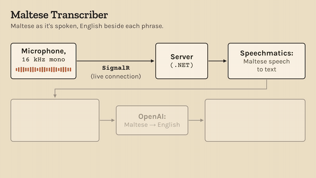
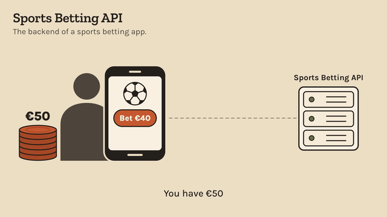
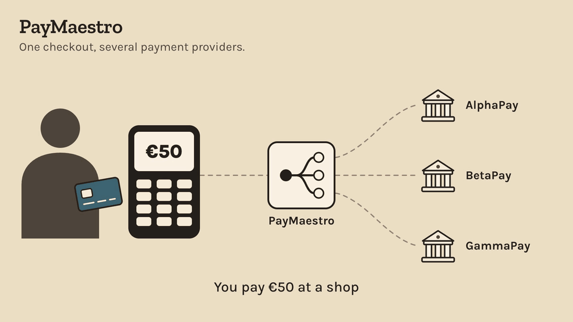
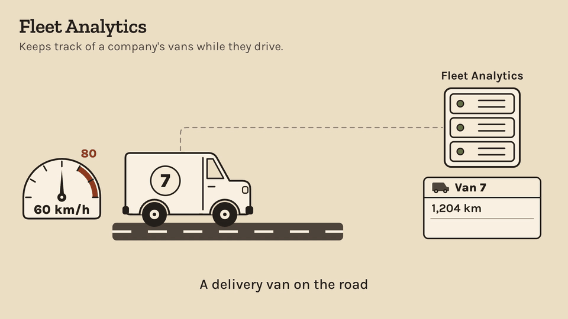
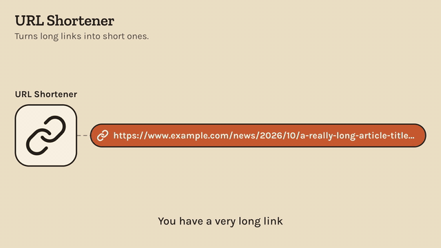
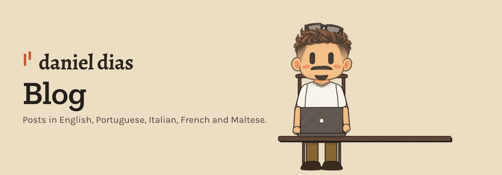
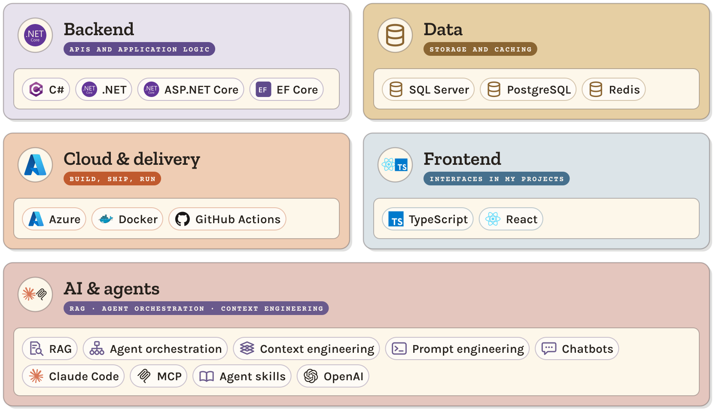
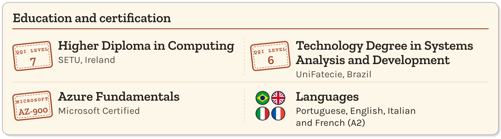

<picture>
  <source media="(prefers-color-scheme: dark)" srcset="assets/logo-dark.svg">
  
</picture>

[**Website**](https://danieldias.dev/en) · [**Blog**](https://danieldias.dev/en/blog) · [**LinkedIn**](https://www.linkedin.com/in/daniel-dias-504168113/) · [**Email**](mailto:daanspfc@gmail.com)

<picture>
  <source media="(prefers-color-scheme: dark)" srcset="assets/lead-dark.svg">
  
</picture>

Software developer focused on backend .NET. I build APIs and run the live projects below.

## Projects

### [Maltese Transcriber](https://maltesetranscriber.mt)

Follow a conversation in Maltese as it happens: the Maltese appears while people speak, with the English beside each phrase.

<a href="https://maltesetranscriber.mt"><picture>
  <source media="(prefers-reduced-motion: reduce)" srcset="assets/how-it-works/maltesetranscriber-still.png">
  
</picture></a>

Live product. The browser streams short audio chunks over SignalR to a .NET server; Speechmatics writes the Maltese and OpenAI translates each finished phrase. 
[Live site ↗](https://maltesetranscriber.mt) · Source private 
.NET · TYPESCRIPT · REACT · SIGNALR

### [Sports Betting API](https://github.com/DeVFirmino/SportsBetting) 

Tap Bet twice by accident and you are charged once, and two bets at the same moment can't spend the same balance.

<a href="https://github.com/DeVFirmino/SportsBetting"><picture>
  <source media="(prefers-reduced-motion: reduce)" srcset="assets/how-it-works/sportsbetting-still.png">
  
</picture></a>

API in .NET 10 for one betting flow: deposit, choose a fixture, place a bet. The wallet debit and the bet commit together, a `rowversion` stops two requests spending the same balance, and a repeated idempotency key never debits twice. 
[Live API ↗](https://sportsbetting-api.nicewave-b8afa4cf.westeurope.azurecontainerapps.io/swagger/index.html) (scales to zero) · [Source](https://github.com/DeVFirmino/SportsBetting) · Tests: [concurrent bets against real SQL Server](https://github.com/DeVFirmino/SportsBetting/blob/develop/tests/Integration.Test/PlaceBetUseCaseTests.cs) · [Deployment notes](https://github.com/DeVFirmino/SportsBetting#deployment) 
.NET · ASP.NET CORE · SQL SERVER · AZURE · Deployed by hand to Azure Container Apps with Azure SQL in September 2026

### [PayMaestro](https://github.com/DeVFirmino/PayMaestro) 

When one payment provider says no, it tries the next one, and you are never charged twice.

<a href="https://github.com/DeVFirmino/PayMaestro"><picture>
  <source media="(prefers-reduced-motion: reduce)" srcset="assets/how-it-works/paymaestro-still.png">
  
</picture></a>

One API in front of several simulated payment gateways. It reserves the idempotency key before calling any gateway and moves to the next gateway on a soft decline. It stops on a hard decline, and when a charge gets no answer it checks that charge with the provider instead of charging again. 
[Source](https://github.com/DeVFirmino/PayMaestro) · Tests: [idempotency race](https://github.com/DeVFirmino/PayMaestro/blob/main/tests/PayMaestro.Tests/IdempotencyReservationTests.cs) · [reconciliation](https://github.com/DeVFirmino/PayMaestro/blob/main/tests/PayMaestro.Tests/ReconciliationTests.cs) 
.NET · ASP.NET CORE · EF CORE · SQLITE · Simulated providers, no real money

### [Fleet Analytics](https://github.com/DeVFirmino/FleetAnalytics)

Vans report where they are as they drive; the kilometres add up, and speeding goes on the van's record.

<a href="https://github.com/DeVFirmino/FleetAnalytics"><picture>
  <source media="(prefers-reduced-motion: reduce)" srcset="assets/how-it-works/fleetanalytics-still.png">
  
</picture></a>

Vehicle telemetry API. Each GPS reading adds the distance driven to the odometer and raises an alert when the vehicle speeds or is due for a service. The reading, its alerts and the odometer update commit in one transaction. 
[Source](https://github.com/DeVFirmino/FleetAnalytics) · Tests: [a failure after the alert is staged saves nothing](https://github.com/DeVFirmino/FleetAnalytics/blob/master/tests/FleetAnalytics.Tests/Services/TripLogIngestionAtomicityTests.cs) 
.NET · ASP.NET CORE · EF CORE · SQLITE

### [URL Shortener](https://github.com/DeVFirmino/UrlShortner) 

Turns a long link into a short one that opens the right page for whoever taps it.

<a href="https://github.com/DeVFirmino/UrlShortner"><picture>
  <source media="(prefers-reduced-motion: reduce)" srcset="assets/how-it-works/urlshortner-still.png">
  
</picture></a>

Three stateless .NET replicas behind nginx, Redis cache-aside in front of Cassandra and collision handling for short codes, all started with one Docker Compose command. 
[Source](https://github.com/DeVFirmino/UrlShortner) 
.NET · REDIS · CASSANDRA · DOCKER

### [danieldias.dev](https://danieldias.dev/en)

My site and blog, in five languages.

The .NET site I build and run. A local tool turns a draft into five language editions and validates each one before it opens a pull request. CI audits the dependencies, and the metrics endpoint sits behind a token. 
[Live site ↗](https://danieldias.dev/en) · Source private 
.NET · RAZOR PAGES · MARKDOWN · DOCKER

<b>Three more projects</b>

 

[**Good Hamburger**](https://github.com/DeVFirmino/good-hamburger) — order management API with combo discount rules, domain-level invariants and integration tests. 
.NET · ASP.NET CORE · EF CORE · XUNIT

[**Book Management**](https://github.com/DeVFirmino/BookManagment) — MVC library lending app. Session action filters keep clients out of the admin pages, and only an administrator can open the client list. That last filter is tested for an administrator, a client and a visitor with no session. 
.NET · ASP.NET CORE MVC · EF CORE · SQL

[**Portfolio Manager**](https://github.com/DeVFirmino/AvaloniaPortifolioManager) — desktop app for clients, investment portfolios, holdings and transactions, built with Avalonia and EF Core. 
.NET · AVALONIA · EF CORE · SQL

## Blog

<a href="https://danieldias.dev/en/blog"><picture>
  <source media="(prefers-reduced-motion: reduce)" srcset="assets/blog-banner-still.png">
  
</picture></a>

.NET, Azure, AI and system design, in English, Portuguese, Italian, French and Maltese. [Read the blog ↗](https://danieldias.dev/en/blog) · [RSS](https://danieldias.dev/en/blog/feed.xml)

<picture>
  <source media="(prefers-color-scheme: dark)" srcset="assets/latest-articles-dark.svg">
  
</picture>

<!-- BLOG-POST-LIST:START -->
- [Half a million small databases: how Brazil counts 125 million votes in one night](https://danieldias.dev/en/blog/how-brazil-counts-125-million-votes-in-one-night) · Oct 2026
- [How troubleshooting changed from the 1950s to 2026](https://danieldias.dev/en/blog/troubleshooting-from-the-1950s-to-2026) · Oct 2026
- [Azure Cosmos DB for RAG: benefits and when to choose it over a relational database](https://danieldias.dev/en/blog/azure-cosmos-db-for-rag-benefits-and-when-to-choose-it) · Sep 2026
- [Kubernetes taints and tolerations explained with a theme park](https://danieldias.dev/en/blog/kubernetes-taints-and-tolerations) · Sep 2026
- [When the LLM gets lost, ask it to update the harness](https://danieldias.dev/en/blog/ask-the-model-to-update-the-harness) · Sep 2026<!-- BLOG-POST-LIST:END -->

**Code that goes with the posts**

- [**kubectl by example**](https://github.com/DeVFirmino/kubectl-by-example): imperative kubectl commands, one CKAD section at a time, each run on a throwaway kind cluster with the real output. Goes with [kubectl by example, part 1: pods](https://danieldias.dev/en/blog/kubectl-by-example-part-1-pods).
- [**OpenTelemetry demo**](https://github.com/DeVFirmino/dotnet-opentelemetry-search): a one-route ASP.NET Core API that shows what OpenTelemetry records on its own. Goes with [OpenTelemetry in .NET](https://danieldias.dev/en/blog/opentelemetry-in-dotnet).
- [**AI Meter**](https://github.com/DeVFirmino/ai-meter): LLM token usage, estimated cost and latency per team, with a request quota for each team. Goes with [AI Meter: run a lab for LLM usage, estimated cost and team limits](https://danieldias.dev/en/blog/ai-meter-usage-and-cost-per-team).
- [**LLM harness example**](https://github.com/DeVFirmino/llm-harness-example): the files an LLM reads before it answers, kept in a repository and updated by review. Goes with [When the LLM gets lost, ask it to update the harness](https://danieldias.dev/en/blog/ask-the-model-to-update-the-harness).
- [**AZ-900 Study Guide**](https://github.com/DeVFirmino/AZ900-Studies): Azure Fundamentals from the concepts up, not memorised answers. Goes with [How I passed AZ-900](https://danieldias.dev/en/blog/how-i-passed-az-900).

## Tech

<picture>
  <source media="(max-width: 600px)" srcset="assets/tech-phone.svg">
  
</picture>

<picture>
  <source media="(max-width: 600px)" srcset="assets/credentials-card.svg">
  
</picture>

## Contact

  
  
  

