

<picture>
  <source media="(prefers-color-scheme: dark)" srcset="assets/logo-dark.svg">
  
</picture>

  &nbsp;
  &nbsp;
  

<a href="https://danieldias.dev/en"><picture>
  <source media="(prefers-reduced-motion: reduce)" srcset="assets/hero-still.png">
  
</picture></a>

<picture>
  <source media="(prefers-color-scheme: dark)" srcset="assets/lead-dark.svg">
  
</picture>

Software developer focused on backend .NET. I build APIs and run the live projects below.

## Projects

### [LearnTranscriber](https://github.com/DeVFirmino/learntranscriber) 

Read what you hear. Ask as you listen.

<a href="https://github.com/DeVFirmino/learntranscriber"><picture>
  <source media="(prefers-reduced-motion: reduce)" srcset="assets/how-it-works/learntranscriber-still.png">
  
</picture></a>

I made LearnTranscriber for the moments in a lesson when a phrase goes by before you’ve worked out what it means. The Mac app transcribes as you listen. You can ask about the phrase in a floating panel and revisit the transcript after the lesson. 
[Download for Mac ↗](https://github.com/DeVFirmino/learntranscriber/releases/latest/download/LearnTranscriber-arm64.dmg) · [Homebrew](https://github.com/learntranscriber/homebrew-tap) · [Website](https://learntranscriber.danieldias.dev) · [Source](https://github.com/DeVFirmino/learntranscriber) · [How it works](https://github.com/DeVFirmino/learntranscriber#how-it-works) 
ELECTRON · REACT · SWIFT · AI · Free and open source under the MIT license

### [racha-bot](https://github.com/DeVFirmino/racha-bot) 

A WhatsApp bot that draws teams from the weekly football list.

<a href="https://github.com/DeVFirmino/racha-bot"><picture>
  <source media="(prefers-reduced-motion: reduce)" srcset="assets/how-it-works/rachabot-still.png">
  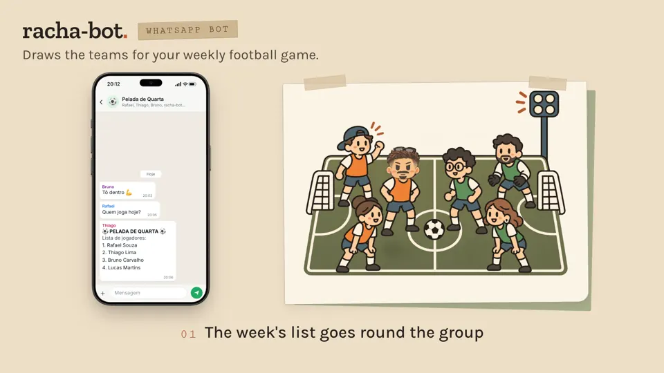
</picture></a>

The organiser replies to the group’s list with the draw command. Once everyone has marked their payment, racha-bot posts the teams as an image, with a goalkeeper on each side. The open-source .NET project includes a simulator for trying the draw outside WhatsApp. 
[Source](https://github.com/DeVFirmino/racha-bot) · [Try it without WhatsApp](https://github.com/DeVFirmino/racha-bot#teste-em-1-minuto-sem-whatsapp) (in Portuguese) 
.NET · WHATSAPP · IMAGESHARP · DOCKER · Free and open source under the MIT license

### Ocllo

A macOS app for following coding agents and reading what they changed.

<picture>
  <source media="(prefers-reduced-motion: reduce)" srcset="assets/how-it-works/ocllo-still.png">
  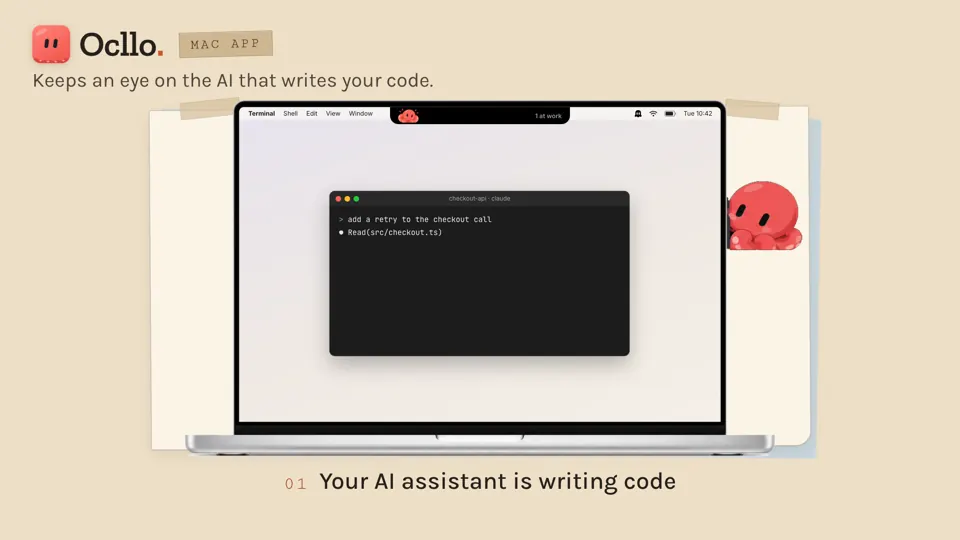
</picture>

When an agent asks a question or needs permission, I can answer from the notch on my Mac. After a turn that adds code, Ocllo can make a card explaining a programming concept with the lines that illustrate it. Sharing code for those cards is opt-in per project. 
Source private 
SWIFT · MACOS · REACT · AI · In progress, no public download yet

### Catidea

A way for volunteers to track counts and neutering in street cat colonies.

<picture>
  <source media="(prefers-reduced-motion: reduce)" srcset="assets/how-it-works/catidea-still.png">
  
</picture>

Volunteers can log a count from their phone and note how many cats have a clipped ear tip, a sign they’ve been neutered. Catidea uses counts taken under the same protocol to show trends. The colony map is private. 
Source private 
.NET · POSTGIS · REACT · TYPESCRIPT

### [AI Meter](https://github.com/DeVFirmino/ai-meter)

A lab for seeing how LLM usage adds up by team.

<a href="https://github.com/DeVFirmino/ai-meter"><picture>
  <source media="(prefers-reduced-motion: reduce)" srcset="assets/how-it-works/aimeter-still.png">
  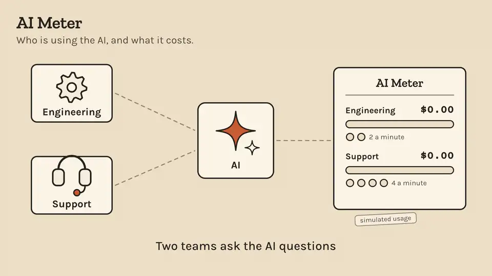
</picture></a>

Send requests as different teams and look at their token use and estimated costs in Grafana. Send enough to reach one team’s request limit and compare the results. The lab uses a simulated model. 
[Source](https://github.com/DeVFirmino/ai-meter) · [Blog post](https://danieldias.dev/en/blog/ai-meter-usage-and-cost-per-team) · [Lab guide](https://github.com/DeVFirmino/ai-meter/blob/main/docs/lab-guide.md) 
.NET · OPENTELEMETRY · GRAFANA · AI · Simulated usage, no real spending

### [URL Shortener](https://github.com/DeVFirmino/UrlShortner) 

A .NET study project that follows a short link from creation to redirect.

<a href="https://github.com/DeVFirmino/UrlShortner"><picture>
  <source media="(prefers-reduced-motion: reduce)" srcset="assets/how-it-works/urlshortner-still.png">
  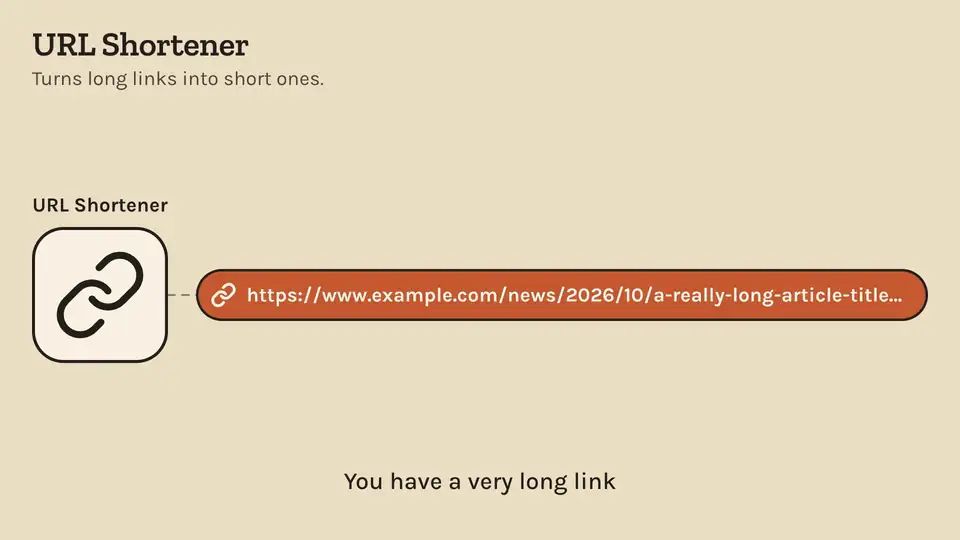
</picture></a>

I built this to see how a shortener’s cache and database work together. The app checks Redis for the short code and looks it up in Cassandra if it’s missing. The project runs locally with Docker Compose. 
[Source](https://github.com/DeVFirmino/UrlShortner) 
.NET · REDIS · CASSANDRA · DOCKER

### [danieldias.dev](https://danieldias.dev/en)

My portfolio and a technical blog in five languages.

<a href="https://danieldias.dev/en"><picture>
  <source media="(prefers-reduced-motion: reduce)" srcset="assets/how-it-works/danielsite-still.png">
  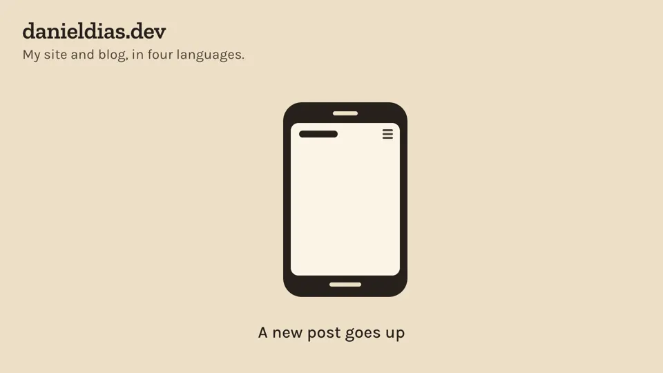
</picture></a>

Each edition of a post lives in its own Markdown file. I built a local tool to prepare and review the translations before a pull request goes up. 
[Live site ↗](https://danieldias.dev/en) · Source private 
.NET · RAZOR PAGES · MARKDOWN · DOCKER

<b>Six more projects</b>

 

[**Sports Betting API**](https://github.com/DeVFirmino/SportsBetting) — a .NET API for trying the same bet request twice and inspecting the saved bet and wallet balance. [Live API ↗](https://sportsbetting-api.nicewave-b8afa4cf.westeurope.azurecontainerapps.io/swagger/index.html) (scales to zero) 
.NET · ASP.NET CORE · SQL SERVER · AZURE

[**PayMaestro**](https://github.com/DeVFirmino/PayMaestro) — a .NET example of when a card payment moves to another provider and when a decline ends the attempt. 
.NET · ASP.NET CORE · EF CORE · SQLITE

[**Fleet Analytics**](https://github.com/DeVFirmino/FleetAnalytics) — a .NET API that saves each GPS reading in the same transaction as the odometer update and any alerts. 
.NET · ASP.NET CORE · EF CORE · SQLITE

[**Good Hamburger**](https://github.com/DeVFirmino/good-hamburger) — a .NET order API that applies combo discounts and stores each item’s price when it’s added to the order. 
.NET · ASP.NET CORE · EF CORE · XUNIT

[**Book Management**](https://github.com/DeVFirmino/BookManagment) — an ASP.NET Core MVC library app with tests that check who can open the client list. 
.NET · ASP.NET CORE MVC · EF CORE · SQL

[**Portfolio Manager**](https://github.com/DeVFirmino/AvaloniaPortifolioManager) — an Avalonia app for tracing how an investment portfolio gets from EF Core to the desktop view. 
.NET · AVALONIA · EF CORE · SQL

## Blog

<a href="https://danieldias.dev/en/blog"><picture>
  <source media="(prefers-reduced-motion: reduce)" srcset="assets/blog-banner-still.png">
  
</picture></a>

.NET, Azure, AI and system design, in English, Portuguese, Italian, French and Maltese. [Read the blog ↗](https://danieldias.dev/en/blog) · [RSS](https://danieldias.dev/en/blog/feed.xml)

<!-- BLOG-POST-LIST:START -->

<a href="https://danieldias.dev/en/blog/one-bot-one-job-tidying-up-grok-bots">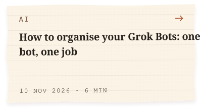</a>
<a href="https://danieldias.dev/en/blog/one-agent-loop-or-many">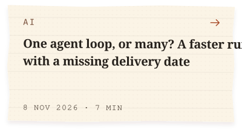</a>

<a href="https://danieldias.dev/en/blog/october-2026-in-17-security-incidents">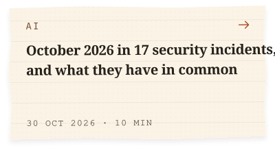</a>
<a href="https://danieldias.dev/en/blog/when-your-rag-pipeline-becomes-an-attack-surface">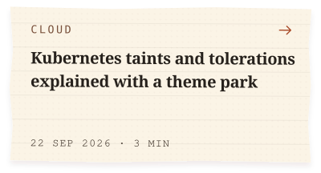</a>

<!-- BLOG-POST-LIST:END -->

<strong>Code that goes with the posts</strong>

<a href="https://github.com/DeVFirmino/kubectl-by-example"><picture>
<source media="(max-width: 600px)" srcset="assets/readme-blog/code-1-phone.svg">
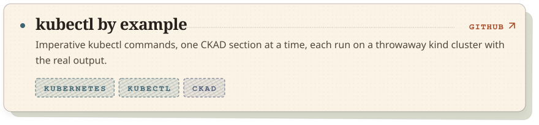
</picture></a>

<a href="https://github.com/DeVFirmino/dotnet-opentelemetry-search"><picture>
<source media="(max-width: 600px)" srcset="assets/readme-blog/code-2-phone.svg">
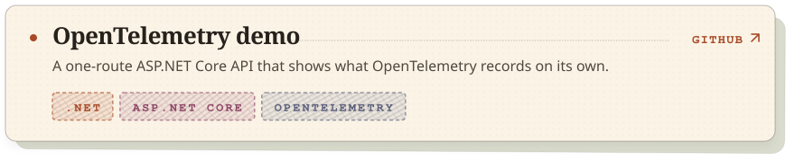
</picture></a>

<a href="https://github.com/DeVFirmino/llm-harness-example"><picture>
<source media="(max-width: 600px)" srcset="assets/readme-blog/code-4-phone.svg">

</picture></a>

<a href="https://github.com/DeVFirmino/AZ900-Studies"><picture>
<source media="(max-width: 600px)" srcset="assets/readme-blog/code-5-phone.svg">
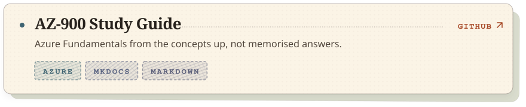
</picture></a>

Read the related articles

<ul><li><a href="https://danieldias.dev/en/blog/kubectl-by-example-part-1-pods">kubectl by example, part 1: pods</a></li><li><a href="https://danieldias.dev/en/blog/opentelemetry-in-dotnet">OpenTelemetry in .NET</a></li><li><a href="https://danieldias.dev/en/blog/ai-meter-usage-and-cost-per-team">AI Meter: run a lab for LLM usage, estimated cost and team limits</a></li><li><a href="https://danieldias.dev/en/blog/ask-the-model-to-update-the-harness">When the LLM gets lost, ask it to update the harness</a></li><li><a href="https://danieldias.dev/en/blog/how-i-passed-az-900">How I passed AZ-900</a></li></ul>

## Tech

<picture>
  <source media="(max-width: 600px)" srcset="assets/tech-phone.svg">
  
</picture>

<picture>
  <source media="(max-width: 600px)" srcset="assets/credentials-card.svg">
  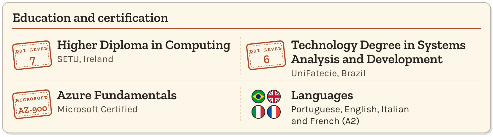
</picture>

## Contact

  

